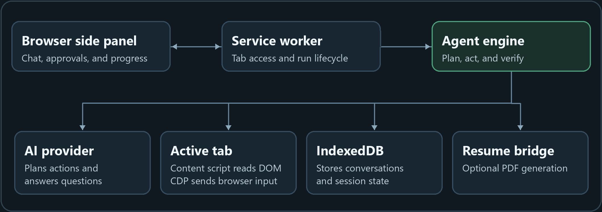

<p align="center">
  
</p>
<h1 align="center">Agent Smith</h1>
<p align="center">An AI side panel for reading, researching, and acting in your browser.</p>
<p align="center"><strong>Chromium extension</strong> · TypeScript · Bring your own model</p>

---

## What Agent Smith can do

| Skill | What it does |
| --- | --- |
| Browser browsing and research | Navigate websites, read open tabs, search the web, and summarize what it finds. |
| Questions and quizzes | Answer questions in chat, read quiz prompts and options from the page, and explain its answers. |
| Browser automation | Click controls, fill forms, and work through multi-step website tasks. Review mode pauses before page input. Turbo handles routine actions automatically and asks for approval on recognized submissions. |
| Resume tailoring | Generate and attach a tailored PDF through the optional local resume bridge. |
| Trading | Analyze visible charts, backtest strategies, replay paper trades, and prepare ExpertOption demo orders for review. |

## Architecture



The agent engine uses the request and conversation to choose between a direct answer and a browser task. For browser tasks, it reads page text and controls through the content script and can capture a screenshot when vision is enabled. It plans the next action with the selected model, runs the action after any required approval, and reads the page again to check the result.

| Component | Source |
| --- | --- |
| Side panel and settings | [src/sidepanel](src/sidepanel) |
| Service worker, agent loop, and model providers | [src/background](src/background) |
| Page observation and action handling | [src/content](src/content) |
| Session storage and shared types | [src/shared](src/shared) |
| Specialized tools | [src/trading](src/trading) and [src/bridge](src/bridge) |

## Get started

1. Clone this repository and open the project folder.
2. Run `npm ci`, then `npm run build`. This generates the `dist/` folder used by the extension.
3. Open `chrome://extensions`, `edge://extensions`, or `brave://extensions` and enable **Developer mode**.
4. Click **Load unpacked** and choose the project root, where `manifest.json` lives.
5. Open Agent Smith and choose a provider and model in Settings.

Run `npm test` to check browser planning, providers, sessions, and trading flows with local fixtures.

## Optional local configuration

Create `.smith.local.json` in the project root if you use Google Antigravity OAuth or the resume bridge. Include the sections you need. Git ignores this file.

```json
{
  "oauth": {
    "clientId": "YOUR_CLIENT_ID",
    "clientSecret": "YOUR_CLIENT_SECRET"
  },
  "resume": {
    "source": "./resume.txt",
    "output": "./tailored",
    "email": "",
    "phone": ""
  }
}
```

For Antigravity, use an OAuth client configured for `http://localhost:51121/oauth-callback`, then rebuild. A build made with local OAuth credentials contains those values in its bundles, so keep that build local.

To run the optional resume bridge, set `SMITH_BRIDGE_TOKEN` to a randomly generated value of at least 32 characters, run `npm run start:bridge`, and enter the same token in Agent Smith Settings. The bridge uses a sample resume template and supports generating PDFs with a local Chrome installation on Windows.

## AI providers

In the side panel, open **Settings**, choose an **AI provider**, enter its credentials, and select **Save and load models**. Choose the model in Settings or search the same catalog in the composer. OpenRouter marks free variants and lists its free router alongside individual models. A custom OpenAI-compatible API uses its base URL, for example https://example.com/v1. If it does not publish a catalog, enter the model ID manually. Turn on screenshots for a model only if it accepts image input.

### OpenCode V1

Run opencode auth login to connect an account in OpenCode. In PowerShell, start a password-protected local server from a dedicated folder:

    $env:OPENCODE_SERVER_PASSWORD = 'your-password'
    $env:OPENCODE_CONFIG_CONTENT = '{"agent":{"agent-smith":{"description":"Browser planner","mode":"primary","permission":"deny"}}}'
    opencode serve --hostname 127.0.0.1 --port 4096

Select **OpenCode** in Agent Smith, enter the server password, and load its connected models. Agent Smith checks the tool-disabled planner profile before sending a prompt.
